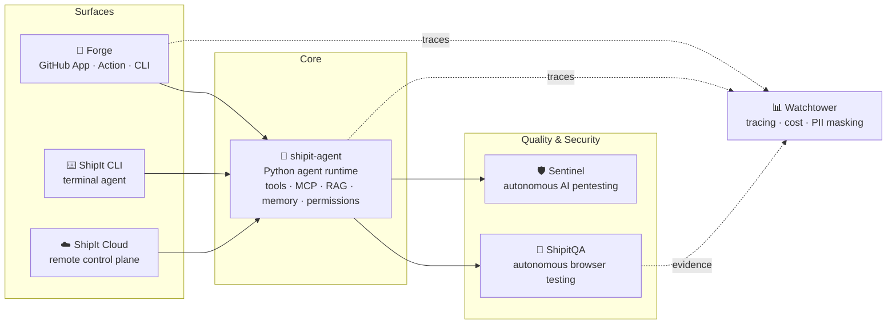

<div align="center">


<br>

**Coding agents · LLM observability · design systems · security · macOS**

<a href="https://docs.shipiit.com/"></a>
<a href="https://pypi.org/project/shipit-agent/"></a>
<a href="https://pypi.org/project/shipit-watcher/"></a>


</div>

---

We build the parts of the toolchain that usually get skipped: the agent that
actually opens the pull request, the runtime underneath it, the trace that
explains what an AI system did and what it cost, and the security pass that
runs before the model and costs nothing.

Everything below is open source. Most of it runs on **your** keys and **your**
infrastructure.

---

## 🗺️ How it fits together

One runtime, many surfaces. The same agent core powers the GitHub teammate,
the terminal, and the cloud — with observability wired through everything.



---

## 🔨 Agents that ship

<table>
<tr><td width="50%" valign="top">

### [ShipIT Forge](https://github.com/shipiit/forge)

**An autonomous coding agent for GitHub.**

Label an issue and it opens a pull request. Comment `/review` and it reviews
one — with a security lens, inline, with committable suggestions. It fixes
failing CI, writes release notes, and answers `/help` from your own codebase.

Three deterministic scanners run **before** the model on every pull request —
committed credentials, infrastructure, and the source code itself — with no
model call and no token cost. A check run publishes the verdict, so a finding
can block a merge.

Hosted GitHub App, GitHub Action, or CLI. Nine providers.

`TypeScript` `MIT` · [**Guide →**](https://shipiit.github.io/forge/)

</td><td width="50%" valign="top">

### [SHIPIT Agent](https://github.com/shipiit/shipit_agent)

**The Python runtime underneath.**

A small, explicit runtime for production agents. You bring an LLM; it gives you
the loop around it — tool calling, retries, streaming, memory, sessions, a
rule-based permission layer, prompt caching, and cost tracking.

Then the batteries: 40+ built-in tools, 17 SaaS connectors, MCP servers, RAG,
skills, hooks, deep multi-agent orchestration and browser automation.

Provider-agnostic by design — the same agent code runs on OpenAI, Anthropic,
Bedrock, Vertex, Gemini, Groq, Together, Ollama, or 100+ models through
LiteLLM. Swap the model in one line; nothing else changes.

`Python 3.11+` `MIT` · [**Docs →**](https://docs.shipiit.com/)

```bash
pip install shipit-agent
```

</td></tr>
</table>

---

## 📊 Know what your AI actually did

### [shipit-watchtower](https://github.com/shipiit/shipit-watchtower)

Observability for LLM applications. One coherent record of what an AI system
did: which prompt ran, what it cost, which tenant it belonged to, which tools
it called, what it retrieved — and why it chose what it chose.

PII is masked **before** anything is persisted or leaves the process, because
masking at display time is theatre once the raw value is on somebody else's
infrastructure. Events fan out to Langfuse for analysis and to your own
database as the system of record, with failures isolated per destination.

`Python 3.11+` `MIT` · zero required dependencies · framework-agnostic

```bash
pip install shipit-watcher
```

---

## 🎨 Design, desktop and security

| | |
|---|---|
| **[KeyVault](https://github.com/shipiit/keyvault)** | A password manager with **no server to trust**. Local-only and zero-knowledge for Chromium browsers: AES-GCM-256 vault under a PBKDF2-derived key, RFC 6238 TOTP with QR scanning, autofill that works on React/Vue apps, a bias-free CSPRNG generator, Watchtower for weak/reused/breached passwords, and importers for 1Password, Bitwarden, LastPass and Chrome. No backend, no account, no telemetry — breach checking is optional, off by default, and never sends the password. <br> `JavaScript` `MIT` · 697 tests · 97% coverage · two runtime deps (preact + jsQR) |
| **[shipit-ui-design](https://github.com/shipiit/shipit-ui-design)** | Senior UI/UX in your terminal — a Claude Code plugin. Eleven skills, nine commands, a nine-category rubric, and a bias toward rich rather than minimal-by-default. Bootstraps design systems, generates polished components, and iterates visually through screenshot critique loops. <br> `TypeScript` `MIT` · [Live →](https://shipit-ui-design.vercel.app) |
| **[ShipIt Palette](https://github.com/shipiit/ShipIt_Palette)** | Pick a color, ship the palette. Fourteen export formats, a live UI playground, and accessibility tools that check contrast where it actually matters. <br> `JavaScript` `MIT` · [Live →](https://shipit-palette.vercel.app) |
| **[Snappilot](https://github.com/shipiit/snappilot)** | The free, open-source Snagit alternative for macOS. Capture, annotate, record and OCR — native Swift, on-device, private. Nothing leaves your machine. <br> `Swift` `SwiftUI` · [Site →](https://snappilot.vercel.app/) |

---

## 📈 The projects at a glance

<div align="center">

| Project | Version | Stars | Language | Last commit |
|---|---|---|---|---|
| [forge](https://github.com/shipiit/forge) |  |  |  |  |
| [shipit_agent](https://github.com/shipiit/shipit_agent) |  |  |  |  |
| [shipit-watchtower](https://github.com/shipiit/shipit-watchtower) |  |  |  |  |
| [shipit-ui-design](https://github.com/shipiit/shipit-ui-design) | — |  |  |  |
| [ShipIt_Palette](https://github.com/shipiit/ShipIt_Palette) | — |  |  |  |
| [snappilot](https://github.com/shipiit/snappilot) |  |  |  |  |
| [keyvault](https://github.com/shipiit/keyvault) | — |  |  |  |

</div>

---

## 🧪 In the lab — coming next

The public repos are the foundation. On top of them, currently in private
development and closed beta:

| | | |
|---|---|---|
| 🛡️ **Sentinel** | Autonomous AI penetration testing — **23 autonomous ReAct attacker agents** that find, validate and explain real vulnerabilities in web apps and APIs: code-level root cause, OWASP mapping, live exploit proof, auditor-ready reports. Multi-tenant SaaS. | *closed beta* |
| 🧪 **ShipitQA** | Evidence-first autonomous product testing — a QA control plane driving real Playwright browsers, with human takeover for OTP/login boundaries and reproducible engineering reports where every issue carries exact evidence. | *in development* |
| ☁️ **ShipIt Cloud** | The cloud control plane — run ShipIt agents remotely on your repos with the same permission layer, cost tracking, and traces you get locally. | *in development* |
| ⌨️ **ShipIt CLI** | The full terminal agent — 65+ tools, 10+ providers, computer use, browser automation, deep research, and two-way Slack / Discord / Telegram / WhatsApp bots. | *preparing OSS release* |

---

## How we build

**Bring your own key.** Nothing here proxies your traffic through us or marks
up a provider's price. You hold the credentials, you see the bill.

**Deterministic where it can be.** A model is good at judging whether something
is reachable and worth worrying about. It is unreliable at checking four
thousand lines the same way twice. So the checks that *can* be deterministic
are, they run first, and they cost nothing.

**Not crying wolf is the hard part.** A scanner people stop reading is worse
than no scanner. A trace nobody trusts is worse than no trace. Most of the work
in these tools is in what they *don't* say.

**Own your data.** Traces land in your database. Usage lands in your SQLite
file. Dashboards are account- or token-gated by default, never public.

---

## 👤 Who's behind ShipIt

ShipIt is built by **[Rahul Raj](https://github.com/iamrraj)** — a full-stack &
AI engineer in Warsaw, Poland, who has shipped production systems across
edtech, automotive, insurance, and health, and now spends his time on one
question: **how far can autonomous agents go before a human needs to step in —
and how do you make that boundary safe, observable, and cheap?**

Every tool here comes from running agents in production and hitting the same
walls: agents that talk instead of committing, traces nobody can read, security
scans nobody trusts, and bills nobody can attribute. ShipIt is the toolchain
that came out of fixing those.

<a href="https://github.com/iamrraj"></a>
<a href="https://iamrraj.com"></a>
<a href="https://www.linkedin.com/in/iamrraj/"></a>
<a href="mailto:rahul@iamrraj.com"></a>

---

<div align="center">

**[Documentation](https://docs.shipiit.com/)** · **[Forge guide](https://shipiit.github.io/forge/)** · **[PyPI](https://pypi.org/user/shipiit/)**

Issues and pull requests are welcome on every repository.

</div>
